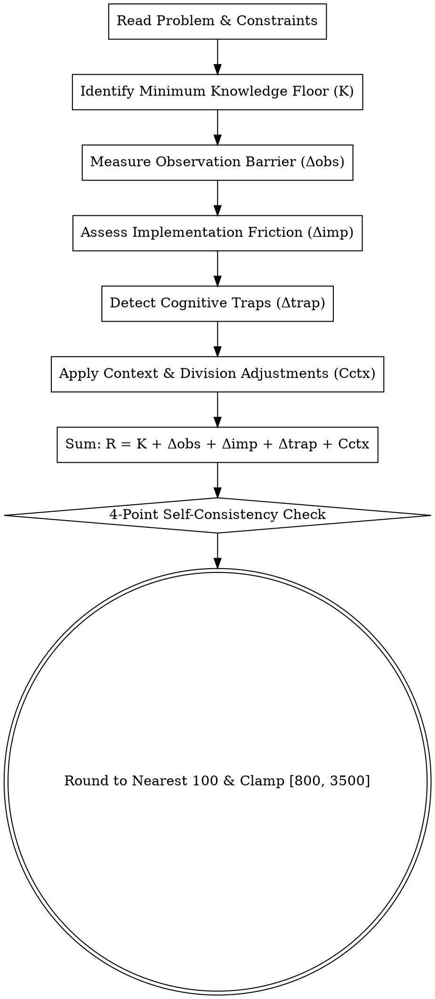

# Codeforces Rating Estimator

## Overview
A quantitative, first-principles methodology to evaluate and predict the Codeforces difficulty rating ($800 - 3500$) of any algorithmic competitive programming problem based on intrinsic cognitive, mathematical, and implementation barriers.

## When to Use
- You are given a competitive programming problem statement, constraints, and time limits, and need to predict its official Codeforces rating.
- You need to determine which contest division or problem position (e.g., Div.2 C vs Div.2 E vs Div.1 B) a problem belongs to.
- You are designing or calibrating a problem set or mock contest and need objective difficulty validation.
- When NOT to use:
  - Non-competitive or non-algorithmic coding questions (e.g., frontend CSS, framework configuration, system design).
  - Subjective opinions on "fun" or "elegance" rather than contest solve probability.



---

## The Core Quantitative Formula

A problem's rating represents the participant rating where the contest solve probability is $\approx 50\%$. Difficulty is calculated through 5 orthogonal dimensions:

$$R_{\text{raw}} = K + \Delta_{\text{obs}} + \Delta_{\text{imp}} + \Delta_{\text{trap}} + C_{\text{ctx}}$$

$$R = \text{clamp}\Big(800, 3500, \text{round}_{100}(R_{\text{raw}})\Big)$$

---

## 1. Algorithmic Knowledge Base Floor ($K$)

The minimum algorithmic prerequisite required to formulate a working solution. If multiple algorithms can solve the problem, $K$ is determined by the **easiest standard algorithm that satisfies the constraints**.

| Knowledge Tier | Standard Rating Floor ($K$) | Typical Prerequisite Topics & Data Structures |
|---|:---:|---|
| **Tier 0: Syntax & Arithmetic** | **800** | Conditionals, basic loops, array indexing, string reversal/concatenation, even/odd parity. |
| **Tier 1: Elementary CP** | **1000** | Sorting ($O(N \log N)$), frequency map/hash array, 1D prefix sums, Euclidean GCD, obvious greedy choice. |
| **Tier 2: Intermediate Elementary** | **1200** | Two pointers, binary search on answer (monotonic predicate), sliding window, simple coordinate compression. |
| **Tier 3: Core Foundations** | **1400** | Unweighted BFS/DFS on grid/tree, basic Disjoint Set Union (DSU), 1D DP ($O(N)$), bitmask operations ($1 \ll k$). |
| **Tier 4: Standard CP Toolkit** | **1600** | Dijkstra shortest path, 2D / Knapsack DP, Fenwick tree (BIT point update range sum), prime sieve / factorization, simple tree queries. |
| **Tier 5: Core Advanced** | **1800** | Segment tree (point update range query), tree DP (post-order), LCA (binary lifting), bitmask DP ($2^N \cdot N$), meet-in-the-middle ($2^{N/2}$), $2 \times 2$ matrix exponentiation. |
| **Tier 6: Upper Advanced** | **2000** | Segment tree with Lazy Propagation (range update), rerooting tree DP, 0-1 BFS with state-space expansion, Tarjan SCC / 2-SAT, general matrix exponentiation for DP transitions. |
| **Tier 7: Expert Techniques** | **2200** | Heavy-Light Decomposition (HLD), Centroid Decomposition, Monotonic Queue / Convex Hull Trick for DP, Dinic Max Flow, DSU with Rollback / Small-to-Large merging. |
| **Tier 8: Specialist Master** | **2400** | Suffix Automaton (SAM) / Suffix Array, FFT / NTT polynomial multiplication, Min-Cost Max-Flow (MCMF), Divide and Conquer DP, Slope Trick, Linear Basis (XOR Gaussian elimination). |
| **Tier 9: Grandmaster Elite** | **2600** | Matroid Intersection, Link-Cut Tree (LCT), Dominator Tree, Formal Power Series / Generating Functions, DP on trees with polynomial convolution, complex duality. |
| **Tier 10: Legendary / International** | **2800+** | Sublinear algorithms, exotic polynomial operations, advanced Dirichlet convolution, research-grade problem structures. |

---

## 2. Observation & Reduction Gap ($\Delta_{\text{obs}}$)

Measures the cognitive distance between reading the literal problem statement and recognizing the algorithmic model. This is where modern Codeforces difficulty primarily resides.

| Level | Value ($\Delta_{\text{obs}}$) | Structural Characteristics & Contestant Obstacles |
|---|:---:|---|
| **Direct (Level 0)** | **$+0$** | Literal problem: "Given an array, query range sum with updates." Zero transformation required. |
| **Single Insight (Level 1)** | **$+100 \sim +150$** | **1 key transformation or perspective shift**: <br>• Time-reversal: offline deletion turned into online insertion.<br>• Index normalization: transform $a_i - i = a_j - j$.<br>• Invariant/Parity: notice that total sum parity is invariant under operations. |
| **Dual Reduction (Level 2)** | **$+200 \sim +300$** | **2 sequential logical steps**: <br>• Step 1 proves monotonicity $\to$ permits binary search on answer.<br>• Step 2 designs a greedy validation check on a tree/dag.<br>• Or: greedy exchange argument + prefix check. |
| **Deep Structural Shift (Level 3)** | **$+350 \sim +500$** | **Non-obvious structural collapse**: <br>• Graph modeling: convert edge-colored subway network into bipartite station $\leftrightarrow$ color nodes to collapse $O(M^2)$ transitions to $O(N + M)$ unweighted BFS.<br>• Invariant preservation: proving characters in string can only leap over smaller elements, reducing sorting to 26 monotonic queues.<br>• Cartesian tree / peak combinatorics: realizing global maximum separates left/right independent subproblems.<br>• Interval state compression: converting an element-by-element history into an active modifier on prefix states. |
| **Mathematical Duality (Level 4)** | **$+550 \sim +750$** | **Deep reformulations**: <br>• Tree distance sum reformulates into edge contribution relative to the optimal centroid.<br>• Min-cut max-flow theorem duality hidden behind an optimization game.<br>• Subtree size polynomials mapped to combinatorial generating functions.<br>• Invariant parity and reduction of multi-step elimination to Fibonacci counting. |
| **Research Breakthrough (Level 5)** | **$+800 \sim +1100$** | **Olympiad / Research breakthrough**: <br>• Permutation cycle decomposition with adjacent cycle bridge preserving weight bound.<br>• Highly non-intuitive constructive algorithms with sub-linear operation budgets (e.g. $\lfloor N/6 \rfloor + 5$).<br>• Grid bootstrap percolation collapsed into laminar reachability forest. |

---

## 3. Implementation Friction & Mechanical Overhead ($\Delta_{\text{imp}}$)

Measures the coding labor, code length, modularity, and risk of implementation bugs during contest conditions.

| Tier | Value ($\Delta_{\text{imp}}$) | Code Scope & Complexity Indicators |
|---|:---:|---|
| **Minimal** | **$-50$** | $< 25$ lines of code. Single loop, standard I/O, virtually zero chance of runtime error or corner bugs. |
| **Standard** | **$+0$** | $30 - 60$ lines. Clean single-pass algorithm, standard BFS/DFS recursion, standard 1D DP. |
| **Moderate** | **$+50 \sim +100$** | $70 - 120$ lines. Coordinate compression + Fenwick tree; difference array with sweep-line; 2-pass tree traversal with state tracking; basic lazy segment tree. |
| **Heavy** | **$+100 \sim +200$** | $120 - 200$ lines. Segment tree with compound lazy tags; 2D geometry with precision handling; multi-state Dijkstra with custom priority queue structs; flat 1D memory-compressed structures for large $N$. |
| **Brutal** | **$+200 \sim +350$** | $200+$ lines. Persistent balanced BST; Heavy-Light Decomposition combined with segment tree range matrix updates; multi-phase data structure interaction. |

---

## 4. Counter-Intuitive Traps & Constraint Tension ($\Delta_{\text{trap}}$)

Measures hidden risks that cause False Confidence, Wrong Answer, Time Limit Exceeded, or contest panic.

| Trap Level | Value ($\Delta_{\text{trap}}$) | Trap Types & Penalties |
|---|:---:|---|
| **Clean** | **$+0$** | Loose constraints ($N \le 100$ or $N \le 2 \cdot 10^5$ with 2.0s), intuitive logic, zero misleading corner cases. |
| **Minor Hazard** | **$+50$** | Standard hazards: 64-bit integer overflow (`long long`), $1$-based vs $0$-based off-by-one, boundary cases ($N=1, K=0$). |
| **Severe Trap** | **$+100$** | • **Greedy mirage**: an intuitive greedy heuristic passes sample tests but fails on subtle counterexamples (causes widespread WA).<br>• **Non-prime modulo**: division is invalid modulo $M$ (cannot use Fermat's Little Theorem for modular inverse).<br>• **Negative weights in DP**: DP states must handle $-\infty$ or subtraction offsets.<br>• **Disconnected / Multi-component graph**: silent runtime errors on disconnected components or isolated nodes. |
| **Extreme Tension** | **$+150$** | • **Strict interactive budget**: queries limited to $\lceil 3N/2 \rceil$ or $2N$, where even 1 redundant query results in WA.<br>• **High constant factor / Tight TL**: $N = 5 \cdot 10^5 \sim 10^6$ with large data structure operations requiring cache-friendly layout and fast I/O.<br>• **Strict memory limit**: $32\text{MB} \sim 64\text{MB}$ or $5000 \times 5000$ grid requiring flat byte arrays to prevent MLE. |

---

## 5. Division, Version & Special Formats ($C_{\text{ctx}}$)

Adjustments based on problem packaging, competitive setting, and presentation:

| Context Factor | Adjustment ($C_{\text{ctx}}$) | Reason |
|---|:---:|---|
| **Easy Version ($C_1, D_1$)** | **$-50 \sim -100$** | Small constraints ($N \le 2000$) permit $O(N^2)$ brute force or eliminates the hard data structure step. |
| **Div.3 / Div.4 Tail Problem** | **$-50$** | Div.3/Div.4 problem statements often contain generous step-by-step samples and hints. |
| **Hard Version ($C_2, D_2$)** | **$+50 \sim +100$** | Requires full mathematical optimization or sub-linear complexity on top of the base insight. |
| **Interactive Format** | **$+50 \sim +100$** | Hidden judge state, flush mechanics, and adaptive judge hazards. |
| **Modern Era Drift (Post-2022)** | **$-50 \sim -100$ for pure DS / $+50$ for pure Ad-hoc** | Standard DS algorithms are widely known and lower rated today; creative ad-hoc requires higher ratings. |

---

## 6. Four-Point Self-Consistency Check

Before finalizing any rating estimate, verify against these 4 checks:

1. **Solve Count / Solve Probability Sanity Check**:
   - Would a typical Candidate Master (Rating 1900) solve this problem in 45 minutes during a contest?
   - If YES $\implies R \le 1900$. If NO (e.g. needs deep discovery or advanced DS) $\implies R > 1900$.
2. **Division Slot Alignment**:
   - Div.4 A-C: 800-900 | Div.4 D-F: 1000-1400
   - Div.3 A-B: 800-900 | Div.3 C-D: 1000-1400 | Div.3 E-G: 1500-2000
   - Div.2 A-B: 800-1300 | Div.2 C: 1400-1700 | Div.2 D: 1800-2100 | Div.2 E: 2100-2400 | Div.2 F: 2400-2700
   - Div.1 A: 1900-2200 | Div.1 B: 2200-2500 | Div.1 C: 2500-2800 | Div.1 D-F: 2800-3500
3. **Minimum Barrier Test**:
   - Can a contestant with knowledge floor $K - 200$ bypass the barrier with a heuristic? If yes, lower $K$.
4. **Implementation vs Insight Balance**:
   - Short code ($<40$ lines) does NOT mean low rating if $\Delta_{\text{obs}} \ge 500$ (e.g., ad-hoc constructive 2400).
   - Long code ($>150$ lines) does NOT mean high rating if $\Delta_{\text{obs}} = 0$ (e.g., basic segment tree casework 1600).

---

## Standard Evaluation Worksheet Template

Whenever evaluating a competitive programming problem, execute the following worksheet systematically:

```markdown
### 1. Problem Classification & Model Extraction
- **Problem Summary**: (1-2 sentences summarizing the core objective)
- **Primary Constraints**: (N, M, values, time limit, memory limit)
- **Target Complexity**: (e.g. O(N log N) time, O(N) memory)
- **Core Algorithmic Model**: (The optimal algorithm chosen)

### 2. Dimension Scoring Breakdown
- **Knowledge Base Floor (K)**: [Score] — [Reasoning: list required algorithms/DS]
- **Observation Barrier (Δobs)**: [Score] — [Reasoning: count and detail cognitive leaps]
- **Implementation Friction (Δimp)**: [Score] — [Reasoning: estimate code length and structural complexity]
- **Trap & Constraint Tension (Δtrap)**: [Score] — [Reasoning: identify potential WA traps, overflow, modulo, bounds]
- **Context Adjustment (Cctx)**: [Score] — [Reasoning: Easy/Hard version, Div context]

### 3. Quantitative Calculation
- **Raw Formula**: R_raw = K + Δobs + Δimp + Δtrap + Cctx = [Sum]
- **Predicted Codeforces Rating**: [Nearest 100 multiple]
- **Confidence Interval**: [Predicted - 50, Predicted + 50]
- **Equivalent Contest Slot**: (e.g. Div.2 C / Div.3 E / Div.1 B)
```

---

## Calibrated Benchmark Reference

Use these real Codeforces anchor problems to calibrate your estimates:

| Problem ID | Name | K | $\Delta_{\text{obs}}$ | $\Delta_{\text{imp}}$ | $\Delta_{\text{trap}}$ | $C_{\text{ctx}}$ | Predicted | Official | Key Insight & Mechanism |
|:---|:---|:---:|:---:|:---:|:---:|:---:|:---:|:---:|:---|
| **1950A** | Stair, Peak, or Neither? | 800 | 0 | -50 | 0 | 0 | **800** | **800** | Simple if-else condition check. |
| **1688B** | Patchouli's Magical Talisman | 800 | 50 | -50 | 0 | 0 | **800** | **800** | Parity analysis + factor of 2 count ($v_2(x)$). |
| **1941C** | Rudolf and the Ugly String | 800 | 150 | -50 | 0 | 0 | **900** | **900** | Greedy deletion: "mapie" overlap resolved by deleting 'p'. |
| **1976B** | Increase/Decrease/Copy | 1000 | 100 | 0 | 50 | -50 | **1100** | **1100** | Greedy interval projection + 64-bit integer overflow. |
| **1984C1** | Magnitude (Easy Version) | 1200 | 150 | -50 | 50 | -50 | **1300** | **1300** | Prefix sum tracking min/max absolute values. |
| **1945D** | Seraphim the Owl | 1000 | 200 | 0 | 50 | +50 | **1300** | **1300** | Backward prefix min sum + best stopping point $\le m$. |
| **1932C** | LR-remainders | 1200 | 200 | 0 | 50 | 0 | **1400** | **1400** | Offline reversal: division by non-prime mod is impossible $\to$ multiply backwards. |
| **1932D** | Card Game | 1000 | 200 | 150 | 50 | 0 | **1400** | **1400** | Trump card matching + greedy pairing within non-trump suits. |
| **1840E** | Character Blocking | 1400 | 150 | 50 | 50 | -50 | **1600** | **1600** | Mismatch counter + FIFO queue for timed unblocking. |
| **1946C** | Tree Cutting | 1200 | 300 | 100 | 50 | 0 | **1600** | **1600** | Binary search on answer + bottom-up greedy subtree pruning. |
| **1870D** | Prefix Purchase | 1400 | 350 | 50 | 50 | 0 | **1800** | **1800** | Convex prefix minimum filtering + greedy unit replacement. |
| **1932F** | Feed Cats | 1600 | 300 | 50 | 0 | -50 | **1900** | **1900** | Difference array sweep + 1D DP on non-overlapping intervals. |
| **1941G** | Rudolf and Subway | 1400 | 450 | 100 | 50 | 0 | **2000** | **2000** | Bipartite modeling: station $\leftrightarrow$ color nodes with unweighted BFS. |
| **1942D** | Learning to Paint | 1800 | 250 | 50 | 50 | -50 | **2100** | **2100** | DP top-k multiway merge with max-heap. |
| **1946E** | Girl Permutation | 1600 | 450 | 50 | 100 | 0 | **2200** | **2200** | Cartesian tree prefix/suffix peak combinatorics. |
| **1898E** | Sofia and Strings | 1600 | 450 | 50 | 100 | 0 | **2200** | **2200** | 26 character queues + monotonic inversion invariant. |
| **1943C** | Tree Compass | 1400 | 750 | 100 | 50 | 0 | **2300** | **2300** | Tree diameter center parity constructive. |
| **1842F** | Tenzing and Tree | 1800 | 550 | 100 | 50 | 0 | **2500** | **2500** | Tree centroid reformulation, edge contribution, BFS depth sorting. |
| **1685D1** | Permutation Weight (Easy) | 1800 | 800 | 100 | 100 | 0 | **2800** | **2800** | Permutation cycle decomposition, DSU adjacent cycle merge, Euler circuit. |

---

## Anti-Patterns & Red Flags

| Red Flag | Fallacy | Correction Rule |
|---|---|---|
| **"Uses Segment Tree $\implies 2000+$"** | Equating standard data structure usage with high rating. | A standard point-update range-sum segment tree is Tier 4 ($K=1600$). If the problem directly asks for range queries with zero disguise ($\Delta_{\text{obs}}=0$), the rating is $1500-1600$, never $2000+$. |
| **"Code is 20 lines $\implies 800-1000$"** | Conflating code length with problem difficulty. | Short code often conceals massive observation barriers (e.g., 1870D Prefix Purchase is 30 lines but rating 1800; 1685D1 is 50 lines but rating 2800). Always score $\Delta_{\text{obs}}$ independently of $\Delta_{\text{imp}}$. |
| **"Looking up or searching the web"** | Hallucinates 3rd-party mirror errors or fails on novel/private contest problems. | **Never rely on lookup.** Evaluate the problem intrinsically via the 5 dimensions. |
| **"Vague rating range (e.g. 1500-1900)"** | 400 points spans an entire rank (Specialist to Candidate Master). | Compute the exact integer sum $K + \Delta_{\text{obs}} + \Delta_{\text{imp}} + \Delta_{\text{trap}} + C_{\text{ctx}}$, round to the nearest 100, and state a tight $\pm 50$ confidence interval. |
| **"Div.2 C is always 1500"** | Ignoring modern rating drift and round hardness. | Problem placement varies across rounds. Compute the intrinsic rating first, then map to typical division placement. |
